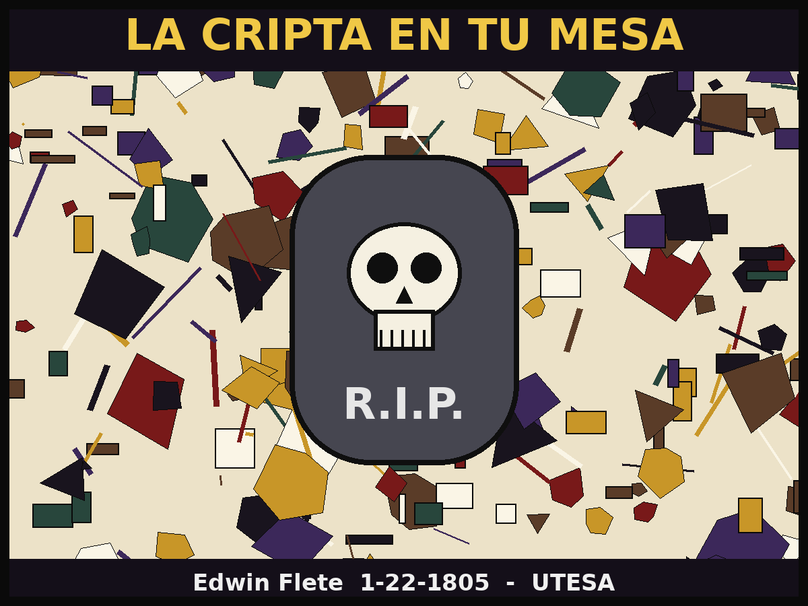

# La Cripta en tu Mesa - Realidad Aumentada (Unity + Vuforia)

Escenario de **realidad aumentada** para Android hecho en Unity 6 con **Vuforia Engine** para la materia Programación de Video Juegos.
Al apuntar la cámara del celular al marcador, aparece sobre la mesa una pequeña cripta con un esqueleto que sale de la tierra, baila con su coro de esbirros, saluda, se duerme y reacciona si lo tocas.

## Autor

- **Estudiante:** Edwin Jesús Flete Cruz
- **Matrícula:** 1-22-1805
- **Universidad:** UTESA, Sede Santiago
- **Asignatura:** Programación de Video Juegos (INF-910-001)
- **Profesor:** Iván Mendoza
- **Motor:** Unity 6 (6000.6.4f1), URP, C#, Input System, Vuforia Engine 11.4

## Descargar y probar

1. Descarga el **APK** desde la sección **Releases** de este repositorio e instálalo en un celular Android (8.0 o superior).
2. Abre `Assets/Resources/Marcador.png` en otra pantalla o imprímelo (unos 20 cm de ancho).
3. Abre la app, acepta el permiso de la cámara y apunta al marcador.

## Abrir el proyecto en Unity

El paquete de Vuforia pesa 138 MB y GitHub no permite archivos de más de 100 MB, por eso no está en el repositorio.
Para abrir el proyecto: descarga **Vuforia Engine 11.4.4** desde https://developer.vuforia.com/downloads/sdk, impórtalo
(**Assets > Import Package > Custom Package**), pega tu licencia en **Window > Vuforia Configuration** y ejecuta **AR > Construir todo**.

## Controles

| Acción | Cómo |
|---|---|
| Hacer aparecer la cripta | Apuntar la cámara al marcador |
| Bailar / Parar | Botón **BAILAR** (salen dos esbirros y bailan juntos con música) |
| Saludar | Botón **SALUDAR** |
| Dormir / Despertar | Botón **DORMIR** (se derrumba y luego revive) |
| Música sí / no | Botón **MÚSICA** |
| Molestar al esqueleto | Tocarlo en la pantalla |
| Probar en PC sin marcador | Tecla **P** durante el Play en Unity |

## Estructura

- `Assets/Scripts/MarcadorAR.cs`: crea el Image Target de Vuforia desde la imagen y muestra u oculta la cripta.
- `Assets/Scripts/ShowCripta.cs`: el "show" (aparecer, baile, saludo, dormir, tocar).
- `Assets/Scripts/BailarinEsqueleto.cs`: animaciones de cada esqueleto.
- `Assets/Scripts/InterfazAR.cs`: textos (nombre y matrícula arriba a la derecha) y botones.
- `Assets/Editor/ConstruirAR.cs`: menú **AR > Construir todo**, que arma el escenario, la escena y los ajustes de Android.

## Créditos

- Esqueletos: **KayKit Skeletons** de Kay Lousberg (CC0).
- Animaciones: **KayKit Character Animations** de Kay Lousberg (CC0).
- Escenario: **KayKit Dungeon Pack** de Kay Lousberg (CC0).
- Realidad aumentada: **Vuforia Engine** de PTC (licencia básica gratuita).
- Música, efectos y marcador: hechos para este proyecto (generados por código).
